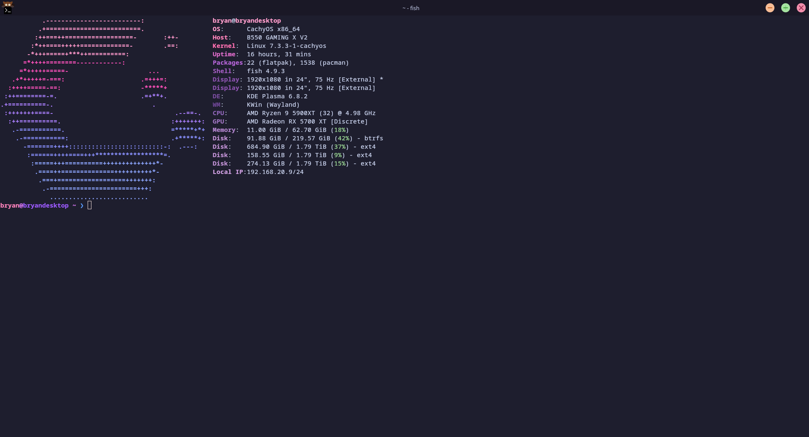
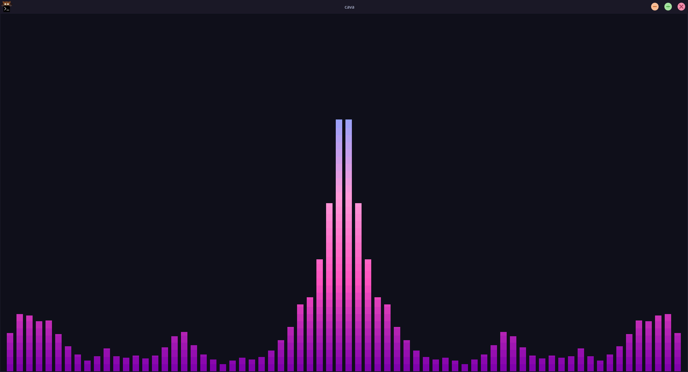

# My Dotfiles

Personal configuration files for my Linux setup.

## Setup

- **OS:** CachyOS (Arch-based)
- **DE:** KDE Plasma 6 (Wayland)
- **Terminal:** [kitty](https://github.com/kovidgoyal/kitty) + [Catppuccin for kitty](https://github.com/catppuccin/kitty)
- **Shell:** [fish](https://github.com/fish-shell/fish-shell)
- **Editor:** [micro](https://github.com/micro-editor/micro) + [Catppuccin for micro](https://github.com/catppuccin/micro)
- **Fetch:** [hyfetch](https://github.com/hykilpikonna/hyfetch) & [fastfetch](https://github.com/fastfetch-cli/fastfetch)

## What's Here

- `fish/config.fish` - Custom prompt with pink/purple colors
- `fastfetch/config.jsonc` - Custom fastfetch output
- `.config/cava/config` - CAVA audio visualizer config
- `.config/cava/themes/` - CAVA color themes
- `.gitconfig` - Git config with GPG signing enabled
- `.gitignore` - Standard ignores

---

## Color Palette

Omnisexual pride colors used across configs:

| Color | Hex |
| --- | --- |
| Pink Light | `#ff9ad9` |
| Pink Main | `#ff53bf` |
| Purple | `#8002ad` |
| Blue Main | `#4363d9` |
| Blue Light | `#8da3ff` |
| Background | `#0F0F1A` |

---

## Preview



Hyfetch in Omnisexual colors with fish and fastfetch custom pink/purple theming.



CAVA audio visualizer with Catppuccin Mocha pink/purple gradient theme.

## Installation

```
git clone https://github.com/neoncircuit0/dotfiles.git
cd dotfiles
```

# Copy fish config
```
cp fish/config.fish ~/.config/fish/config.fish
```

# Copy git config
```
cp .gitconfig ~/.gitconfig
```

# Copy fastfetch config
```
mkdir -p ~/.config/fastfetch
cp fastfetch/config.jsonc ~/.config/fastfetch/config.jsonc
```

# Copy CAVA config
```
mkdir -p ~/.config/cava/themes
cp .config/cava/config ~/.config/cava/config
cp .config/cava/themes/* ~/.config/cava/themes/```
```

## License

[GPL v3](LICENSE)
